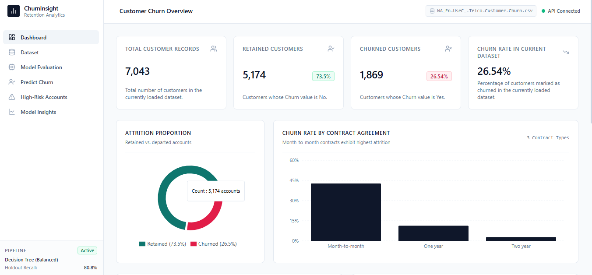
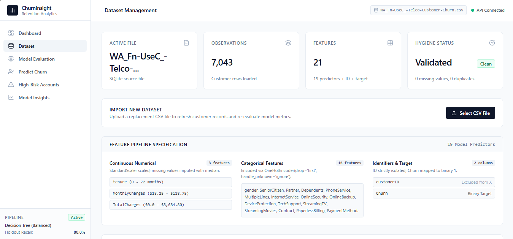
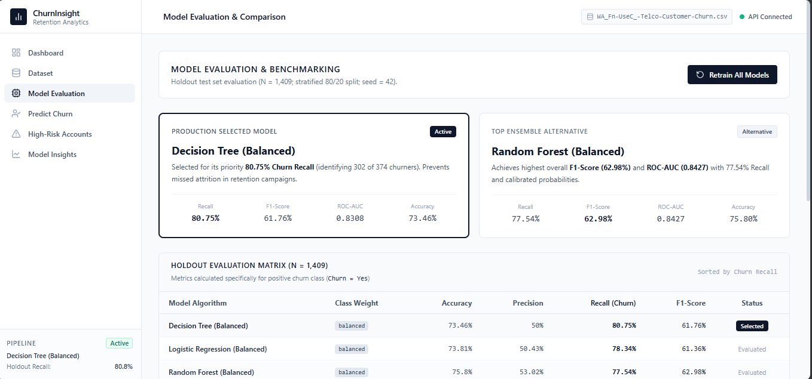
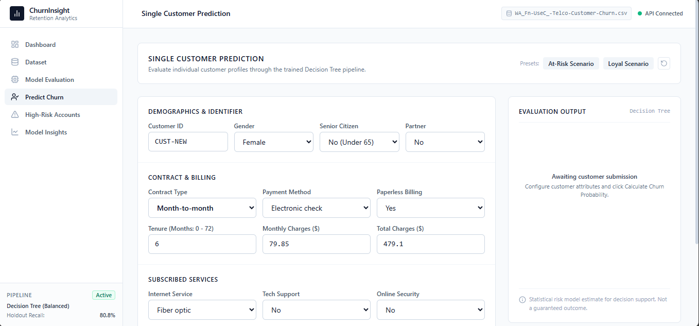
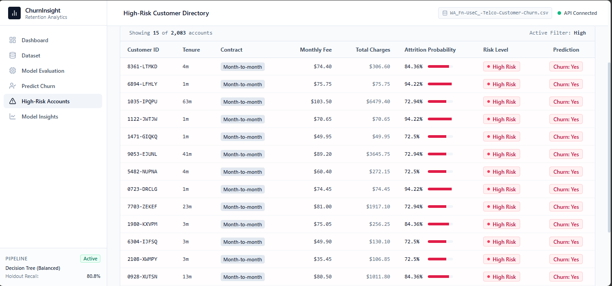
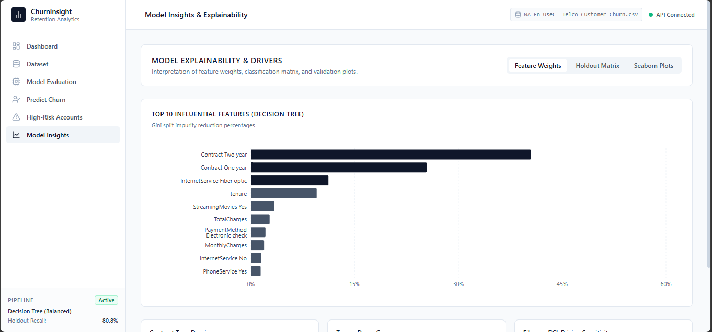
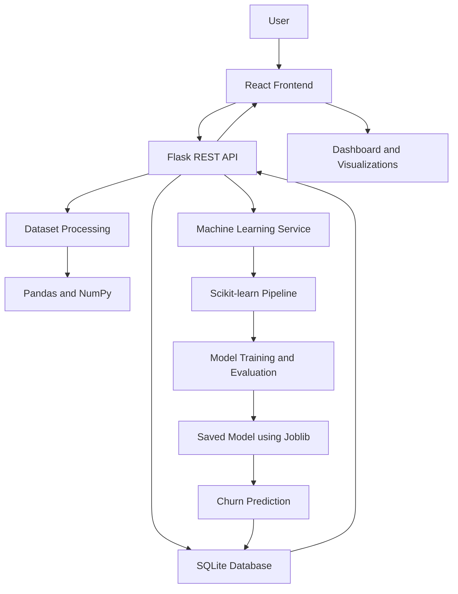

# ChurnInsight AI – Customer Churn Prediction System

An end-to-end Machine Learning application that predicts customer churn, identifies high-risk customers, and provides actionable insights to support customer retention strategies.

ChurnInsight AI uses historical customer data to train and evaluate multiple machine learning models. It provides an interactive dashboard where users can explore customer data, analyze churn patterns, compare model performance, and predict the probability of customer churn.

---

## 📌 Overview

Customer churn is a major challenge for subscription-based businesses. Identifying customers who are likely to leave helps businesses take preventive actions and improve customer retention.

ChurnInsight AI addresses this problem using machine learning techniques to:

- Predict whether a customer is likely to churn.
- Estimate the probability of customer churn.
- Identify high-risk customers.
- Analyze important factors influencing churn.
- Compare different machine learning algorithms.
- Visualize customer churn patterns through an interactive dashboard.

The application provides a complete workflow, from dataset preprocessing and model training to prediction and visualization.

---

## ✨ Key Features

- **Interactive Dashboard:** View customer statistics, churn distribution, and important business insights.
- **Dataset Management:** Upload, preview, and explore customer datasets.
- **Data Preprocessing:** Handle missing values, encode categorical variables, and scale numerical features.
- **Model Training:** Train and compare multiple machine learning algorithms.
- **Churn Prediction:** Predict churn probability for individual customers.
- **High-Risk Customer Identification:** Identify customers with a high probability of leaving.
- **Model Evaluation:** Analyze accuracy, precision, recall, F1-score, and ROC-AUC.
- **Feature Importance:** Understand the major factors influencing customer churn.
- **Data Visualization:** Explore churn patterns using interactive charts and graphs.

---

## 🖥️ Dashboard Preview

The application contains six main sections.

### 1. Dashboard

Provides an overview of customer statistics, churn distribution, and important churn patterns.



### 2. Dataset Management

Allows users to upload customer datasets, view dataset information, and explore customer records.



### 3. Model Evaluation

Displays model comparison results and evaluation metrics to help understand model performance.



### 4. Churn Prediction

Allows users to enter customer details and predict the probability of churn.



### 5. High-Risk Accounts

Displays customers identified as having a high probability of churn.



### 6. Model Insights

Visualizes feature importance and provides insights into the factors influencing customer churn.



---

## 🏗️ System Architecture

ChurnInsight AI follows a full-stack architecture where the React frontend communicates with a Flask backend through REST APIs.

The backend handles dataset processing, database operations, machine learning training, and predictions.



### Architecture Components

| Component | Responsibility |
|---|---|
| React Frontend | User interface and dashboard |
| Flask Backend | API handling and application logic |
| SQLite | Stores customer records and application data |
| Pandas and NumPy | Data processing and numerical operations |
| Scikit-learn | Model training and evaluation |
| Joblib | Saving and loading trained models |
| Recharts | Interactive frontend visualizations |
| Matplotlib and Seaborn | Model evaluation plots |

---

## 📊 Dataset

This project uses the **IBM Telco Customer Churn Dataset**, which contains customer information and service-related details.

The dataset is used to identify patterns associated with customer churn.

### Original Training Dataset Statistics

| Attribute | Value |
|---|---:|
| Total Records | 7,043 |
| Total Columns | 21 |
| Predictive Features | 19 |
| Target Variable | Churn |
| Retained Customers | 5,174 |
| Churned Customers | 1,869 |
| Original Churn Rate | 26.54% |

### Target Variable

The target variable is `Churn`.

- `No` – Customer continues using the service.
- `Yes` – Customer has discontinued the service.

### Data Preprocessing

The following preprocessing steps are performed:

1. Remove unnecessary identifiers such as `customerID` from model training.
2. Convert numerical columns into appropriate data types.
3. Handle missing and invalid values.
4. Replace blank `TotalCharges` values with `0.0` for the zero-tenure records.
5. Encode categorical variables using One-Hot Encoding.
6. Scale numerical features using StandardScaler.
7. Split the dataset into training and testing sets.

The dataset is split using an 80:20 train-test ratio with stratification to preserve the target class distribution.

---

## 🤖 Machine Learning Pipeline

The application uses Scikit-learn pipelines to ensure consistent preprocessing during both model training and prediction.

### Models Implemented

The following six model configurations are evaluated:

1. Decision Tree – Default
2. Decision Tree – Balanced
3. Random Forest – Default
4. Random Forest – Balanced
5. Logistic Regression – Default
6. Logistic Regression – Balanced

### Model Evaluation Metrics

The models are evaluated using:

- **Accuracy:** Overall percentage of correct predictions.
- **Precision:** Percentage of predicted churners who actually churned.
- **Recall:** Percentage of actual churners correctly identified.
- **F1-Score:** Harmonic mean of precision and recall.
- **ROC-AUC:** Measures the model's ability to distinguish between churn and non-churn customers.

---

## 📈 Model Performance

The following results were obtained from the stratified test dataset containing 1,409 records, including 374 actual churn cases.

| Model | Accuracy | Precision | Recall | F1-Score | ROC-AUC |
|---|---:|---:|---:|---:|---:|
| Decision Tree (Balanced) | 73.46% | 50.00% | **80.75%** | 61.76% | 0.8308 |
| Random Forest (Balanced) | 75.80% | 53.02% | 77.54% | **62.98%** | 0.8427 |
| Logistic Regression (Balanced) | 73.81% | 50.43% | 78.34% | 61.36% | 0.8417 |
| Logistic Regression (Default) | 80.62% | 65.93% | 55.88% | 60.49% | 0.8422 |
| Random Forest (Default) | 80.41% | 66.55% | 52.67% | 58.81% | 0.8433 |
| Decision Tree (Default) | 79.42% | 63.12% | 54.01% | 58.21% | 0.8267 |

*Note: Precision, Recall, and F1-score are calculated for the positive class (Churn = Yes).*

### Selected Model: Decision Tree (Balanced)

The Balanced Decision Tree model is selected because it achieves the highest recall of **80.75%** among the evaluated models.

Recall is important in this project because failing to identify customers who are likely to leave can result in missed retention opportunities.

### Confusion Matrix

The selected model produced the following results on the test dataset:

| | Predicted No | Predicted Yes |
|---|---:|---:|
| Actual No | 733 | 302 |
| Actual Yes | 72 | 302 |

The model correctly identified 302 out of 374 actual churn cases.

Although the selected model identifies more potential churners, it also produces false positives. Therefore, its predictions should be used as decision-support information rather than guaranteed outcomes.

---

## 🛠️ Technology Stack

### Frontend

- React 18
- Vite
- Tailwind CSS
- Recharts
- Axios
- Lucide React

### Backend

- Python
- Flask
- Flask-SQLAlchemy
- SQLAlchemy
- Flask-CORS

### Database

- SQLite

### Machine Learning and Data Processing

- Scikit-learn
- Pandas
- NumPy
- Joblib
- Matplotlib
- Seaborn

---

## 📂 Project Structure

```text
ChurnInsight-AI/
│
├── backend/
│   ├── app/
│   │   ├── models/
│   │   ├── routes/
│   │   ├── services/
│   │   ├── ml/
│   │   └── utils/
│   │
│   ├── database/
│   ├── saved_models/
│   ├── uploads/
│   ├── config.py
│   ├── run.py
│   └── requirements.txt
│
├── frontend/
│   ├── src/
│   │   ├── components/
│   │   ├── pages/
│   │   ├── services/
│   │   ├── App.jsx
│   │   └── main.jsx
│   │
│   ├── public/
│   ├── package.json
│   └── vite.config.js
│
├── dataset/
│   └── WA_Fn-UseC_-Telco-Customer-Churn.csv
│
├── notebooks/
│
├── Screenshot/
│   ├── dashboard.png
│   ├── Dataset.png
│   ├── Model_Evaluation.png
│   ├── Predict_churn.png
│   ├── High-Risk_Accounts.png
│   └── Model_Insights.png
│
├── README.md
└── .gitignore
```

*Note: This is the documented project structure. Ensure the folder and file names match your actual repository.*

---

## ⚙️ Installation and Setup

Follow these steps to run ChurnInsight AI locally.

### Prerequisites

Make sure the following are installed:

- Python 3.10 or later
- Node.js and npm
- Git

### 1. Clone the Repository

```bash
git clone https://github.com/sai-ganesh-a/churn_predictor.git
cd churn_predictor
```

### 2. Backend Setup

Navigate to the backend directory:

```bash
cd backend
```

Create a virtual environment:

```bash
python -m venv venv
```

Activate the virtual environment on Windows:

```powershell
.\venv\Scripts\Activate.ps1
```

Install the required dependencies:

```bash
pip install -r requirements.txt
```

Start the Flask backend:

```bash
python run.py
```

The backend will run at:

http://127.0.0.1:5000

### 3. Frontend Setup

Open a new terminal and navigate to the frontend directory:

```bash
cd frontend
```

Install frontend dependencies:

```bash
npm install
```

Start the React development server:

```bash
npm run dev
```

Open the frontend URL displayed in the terminal.

By default, Vite uses:

http://localhost:5173

If your `vite.config.js` specifies a different port, use that port instead.

---

## 🧪 Testing and Validation

The application should be tested across the following areas:

- Dataset loading and preprocessing.
- Model training and evaluation.
- Individual customer predictions.
- Batch customer predictions.
- API response validation.
- Database operations and persistence.
- Frontend and backend integration.
- CSV upload and dataset validation.
- Error handling for invalid inputs and missing data.

Model evaluation results are generated using a separate holdout test dataset.

---

## 🚀 Future Improvements

Possible improvements for future versions include:

- Hyperparameter tuning for better model performance.
- Testing additional machine learning algorithms.
- Explainable AI using SHAP or LIME.
- Automated retention recommendations.
- Model monitoring and performance tracking.
- Improved handling of changing customer datasets.
- Deployment to a cloud platform.
- User authentication and role-based access.

---

## ⚠️ Limitations

- Model predictions depend on the quality and characteristics of the training dataset.
- Historical customer behaviour may not represent future customer behaviour.
- False positives and false negatives are possible.
- The selected model prioritizes churn recall, which may increase false-positive predictions.
- Prediction results should support business decisions and should not be treated as guaranteed outcomes.
- Model performance may change when a different dataset is uploaded.

---

## 🙏 Acknowledgements

- **IBM** – For providing the Telco Customer Churn dataset.
- **Scikit-learn** – For machine learning algorithms and preprocessing tools.
- **Flask** – For backend API development.
- **React** – For frontend development.

---

## 👨‍💻 Author

**Sai Ganesh A**

GitHub: [sai-ganesh-a](https://github.com/sai-ganesh-a)

---

⭐ If you find this project useful, consider giving the repository a star!